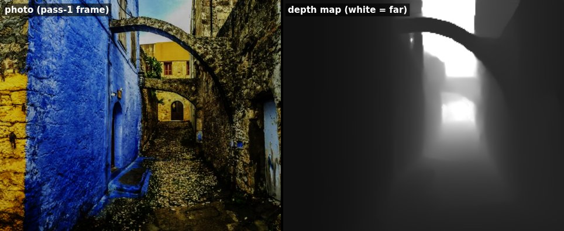

# Scene depth

A per-pixel depth map for the Street View frame, estimated from the frame
itself by a monocular depth network, so fog, rain, depth of field and the hop
release follow the street's real shape instead of a screen-Y gradient (#320).

Off by default. It downloads about 25 MB once (runtime + model), so the user
opts in from the weather panel (**🧊 Scene depth**) or with `?depth=on`. It only
has an effect at High and Ultra quality (`depthBlend` 0.6 / 0.8); at Low and
Medium the weight is 0 and nothing is downloaded.



---

## What it changes

| Effect | Without depth (the proxy) | With scene depth |
|---|---|---|
| Fog extinction | a band at the horizon line — a wall at arm's length above the horizon is "infinitely far" and fully fogged | fog pools down the street; near walls stay clear ([fog](looks/scene-depth/fog-webgpu.jpg)) |
| Depth of field | everything above the horizon blurs | the near scene is sharp, the far end softens ([dof](looks/scene-depth/dof-webgpu.jpg)) |
| Rain / snow | streak brightness boosted toward the bottom of the frame | streak layers farther than the nearest surface are occluded (no far rain in front of a near wall) ([rain](looks/scene-depth/rain-webgpu.jpg) — subtle in a still, rain is short dashes at one instant) |
| Hop release | a 250 ms crossfade from the held frame | the held frame dollies along the hop: near pixels move more than the skyline ([dolly](looks/scene-depth/dolly-webgpu.jpg)) |

All four read one function, `sceneDepth(uv, horizonY)` in both weather shaders
(`weather-post/01-foundation.wgsl`, `weather-post-compute.wgsl`), and the dolly
in `streetview.wgsl`. The pictures come from `npm run capture:depth-looks`
(below); the e2e asserts the same things numerically.

**Weight 0 is bit-exact.** With no map, a stale map, scene depth off, or a
Low/Medium preset, the params block is all zero: `sceneDepth` returns
`viewDepthProxy` before touching the map, rain/snow keep their original
accumulate statement, and the release keeps `samplePrevWithLookAround`.
`weatherShaderParity.test.ts` pins the branches; `e2e/scene-depth.spec.ts`
compares frames byte for byte with the map bound at weight 0.

---

## Pipeline

```
pass-1 HDR intermediate ──gpuChores.downsampleTexture──▶ RGBA8, ≈252² at the canvas aspect
   (the road's own frame;        (sides multiples of 14, the ViT patch)
    never the Maps canvas)
        ──linear→sRGB, ImageNet NCHW──▶ depth Worker
                                         onnxruntime-web 1.30 WebGPU EP, own GPUDevice
                                         Depth Anything V2 Small (q4f16 / q4)
        ◀──relative inverse depth (Float32Array, transferred)
        ──normalise (percentiles) + calibrate to the proxy + EMA──▶ half floats
        ──writeTexture──▶ r16float on the road's device ──▶ FrameContext.aux.depth
                                                             ├─ weather group 2: sceneDepth()
                                                             └─ pass 1 group 1: release dolly
```

| Module | Owns |
|---|---|
| `renderer/depth/DepthController.ts` | the lazy, optional `depth` `FramePass`; inference loop; upload; per-frame params |
| `renderer/depth/depthScheduler.ts` | when to infer (below) |
| `renderer/depth/DepthEstimator.ts` / `depthWorker.ts` / `depthProtocol.ts` | the Worker: runtime import, device, session, inference |
| `renderer/depth/depthModelCache.ts` | the one-time, verified download into the Cache API |
| `renderer/depth/depthMath.ts` | sRGB re-encode, ImageNet tensor, normalisation + calibration, f16 packing |
| `renderer/depth/depthParams.ts` | trust (confidence), look-around shift, dolly direction |
| `renderer/depth/sceneDepthBinding.ts` | `FrameAux`, the shared bind-group layout, the zero fallback, `SceneDepthParams` indices |
| `renderer/depth/depthModel.ts` + `depthModel.manifest.json` | pins: model revision, files, sizes, SHA-256, runtime version |
| `state/sceneDepthStore.ts` | the opt-in (persisted; `?depth` wins) |
| `renderer/depth/sceneDepthStatsStore.ts` | status for the panel, the performance overlay and `window.__SCENE_DEPTH__` |

### Cadence

Depth is a slowly-varying scene input. It runs when the map is stale — a new
pano (the hold released) or a different view (pan / zoom) — once look input has
settled for 150 ms, at most 5 Hz, one inference in flight, **never** while a
hold is active or a transition (release crossfade, year-chip wipe) is running,
plus one refresh 1.2 s after a release because Street View keeps sharpening
tiles. A map that finishes after the pano changed is dropped. Between maps the
current one is reprojected by the look-around since it was inferred (the
hold-pause mapping: 4 / 2.8 screens per pan unit), with coverage fading to the
proxy where the shifted map runs out.

### From disparity to the proxy's scale

Depth Anything predicts affine-invariant inverse depth — unknown scale and
shift — so raw values mean nothing. Each map is stretched to "nearness"
`n ∈ [0, 1]` between its 2nd and 98th percentiles, then `depth = q / n`
(clamped to 1): distance goes as 1 / disparity, and this is the same hyperbola
`viewDepthProxy` uses (`0.06 / (y − horizon)`). `q`, the depth of the nearest
disparity, is calibrated per scene against the proxy on the ground right in
front of the camera (bottom-centre band, where a Street View frame looks at the
road and the proxy is a fair metric estimate), clamped to [0.04, 0.3], with a
default of 0.1 when the view looks up. That keeps the two cues on one scale, so
blending them never fogs the road under the camera. Range, `q` and (for the
same view) texels are eased across inferences.

### Trust

`blend = depthBlend × confidence`. Confidence drops to 0 the moment the pano
changes (the old map labels a different street) and eases back over ~160 ms
when a fresh map of this view lands; a zoom change also zeroes it until the next
map. The release dolly uses the map of the pano being *left*, so it is valid
exactly during the release that follows a hold.

---

## Device, runtime and bundle

- **Its own device, in a Worker.** onnxruntime-web 1.30 can take an external
  device (`env.webgpu.device`), but a `GPUDevice` cannot be posted into a
  Worker, and running the model on the main thread against the road's device
  would put ORT's graph optimisation on the main thread and let a model fault
  (out-of-memory, a kernel validation error, a lost device) take the road frame
  down with it. The Worker requests one device and hands it to ORT, so ORT never
  makes a third. `deviceInit.test.ts` pins exactly two `requestDevice` call
  sites: `bootDevice.ts` (main thread) and `depthWorker.ts`.
- **`shader-f16`** is requested on the depth device when the adapter has it; that
  is what runs the `q4f16` variant (f16 activations, 19 MB). Without it the `q4`
  variant (f32 activations, 27 MB) runs. The road's device still does not request
  `shader-f16` — no road shader uses `f16`.
- **Runtime from a pinned CDN URL**, imported inside the Worker
  (`https://cdn.jsdelivr.net/npm/onnxruntime-web@1.30.0/dist/ort.webgpu.min.mjs`,
  ≈5.5 MB of WebAssembly, brotli). No npm dependency; the Worker itself is ~2 KB
  gzip. `depthBundleGuard.test.ts` and `scripts/check-bundle-budget.sh` fail if
  ORT code or an `.onnx` ever lands in `build/static`.
- **No threads / `SharedArrayBuffer`** (`numThreads = 1`): the page is not
  cross-origin isolated, and COOP/COEP would break the Maps embed.

## The model

| | |
|---|---|
| Model | **Depth Anything V2 Small** — ONNX export [`onnx-community/depth-anything-v2-small`](https://huggingface.co/onnx-community/depth-anything-v2-small) at revision `4472b7362082ad9968fee890ca0f1e5aca36b93d` |
| Upstream | [`depth-anything/Depth-Anything-V2-Small-hf`](https://huggingface.co/depth-anything/Depth-Anything-V2-Small-hf) |
| License | **Apache-2.0** (both). **Base and Large are CC-BY-NC-4.0 and must not be used.** |
| Files | `depth-anything-v2-small.q4f16.onnx` (19.1 MB, sha256 `eca72971…f1e`), `depth-anything-v2-small.q4.onnx` (27.4 MB, sha256 `5d55b027…cf8`) — quantised by the source repository, served unmodified |
| Input / output | `pixel_values` `[1, 3, H, W]` (ImageNet mean/std on sRGB) → `predicted_depth` `[1, H, W]`, relative inverse depth |

**Not in git.** `npm run fetch:depth-model` downloads both pinned files into
`public/models/depth/` (gitignored), verifies size and SHA-256, and writes a
`NOTICE.txt` with the attribution beside them; `--check` verifies without
downloading. The deploy workflow runs it before `npm run build`, so the files
ship under `build/models/depth/`. A deploy without them still works — scene
depth reports `failed` with "model not deployed" and every effect keeps the
proxy.

**Cached once.** The Worker keeps the verified file in a Cache API bucket
(`streetview-depth-model-v<cacheVersion>`) and deletes older
`streetview-depth-model-*` buckets. The service worker never intercepts
`/models/` and its activate cleanup never touches that bucket (`swPolicy.test.ts`).
Bump `cacheVersion` in the manifest when a file or hash changes.

Updating the pins: change the revision / hashes / sizes in
`depthModel.manifest.json` (the HF tree API lists LFS sha256 and sizes), bump
`cacheVersion`, run `npm run fetch:depth-model`, `npm run test:e2e -- e2e/scene-depth.spec.ts`
and `npm run capture:depth-looks`.

---

## Status and failure

- `webgpuProbe.passes.depth` — absent until scene depth is first switched on
  (the pass is lazy), then `ready` or `failed(reason)`. A failure never touches
  the road frame: consumers bind the zero fallback.
- `window.__SCENE_DEPTH__` — `state`, `reason`, `variant`, `shaderF16`,
  `fromCache`, `inferenceMs`, `cadenceHz`, input size, applied weight.
- Performance overlay (**P**) — "Scene depth: 38ms · 2.0 Hz · w 0.80".
- Failures and what they mean: *model not deployed (HTTP 404)* /
  *integrity check failed* (deploy without `fetch:depth-model`, or a bad file);
  *needs the GPU chores readback* (`?no_gpu_compute`, or the adapter failed the
  chores limits — depth has no other way to read the frame); *depth device
  lost*. A failure is not retried every frame; switching scene depth off and on
  retries.

## Testing

| | |
|---|---|
| `src/renderer/depth/*.test.ts` | math (percentiles, calibration, f16 vs `Float16Array`), cache (download once, integrity, stale buckets), scheduler, params, the controller on the fake device with a scripted Worker, the bundle guard |
| `Renderer.depth.test.ts` | lazy pass, aux reaching pass 1 and weather, failure reporting and retry |
| `weatherShaderParity.test.ts`, `sceneDepthBinding.test.ts`, `windshieldPortal.parity.test.ts` | the WGSL side: identical helpers in both paths, the weight-0 branches, one params layout, depth never reaching a stage the windshield portal mirrors |
| `e2e/scene-depth.spec.ts` (`chromium-webgpu`) | the real model on SwiftShader through the production renderer: runs with no validation errors; weight 0 bit-exact; fog, rain, DOF and the dolly change the frame the way they should; second visit from the Cache API; a bad model fails the pass, not the frame |

SwiftShader takes about a minute per inference at ≈252² — the lane asserts the
model *runs*. The issue's ≤ 60 ms budget is a real-GPU number and is not
measured in CI; read `inferenceMs` on the overlay on a GPU host.

`npm run capture:depth-looks` (with a dev server and the model fetched)
regenerates `docs/looks/scene-depth/` from the CC0 fixture photo — no Maps key,
no billable panorama load. On a WebGPU host with a Maps key,
`npm run capture:look-goldens` also captures each look with `&depth=on`.

## Known limits

- Relative depth only — no metric scale, no SLAM, no multi-pano fusion.
- One map per settled view; while looking around, the last map is reprojected
  (2-D shift) until the next one lands, and fades to the proxy where it runs out.
- The windshield portal's lens mirror does not include fog or DOF, so it does not
  include their depth either (the existing, documented delta).
- The dolly needs the hop's link heading: teleports, search and globe jumps keep
  the crossfade. Its focus of expansion is the view centre, so a hop that is
  mostly sideways is a lateral slide rather than a push.
